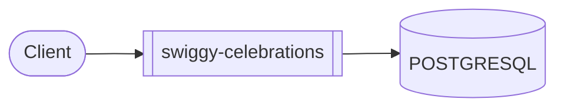
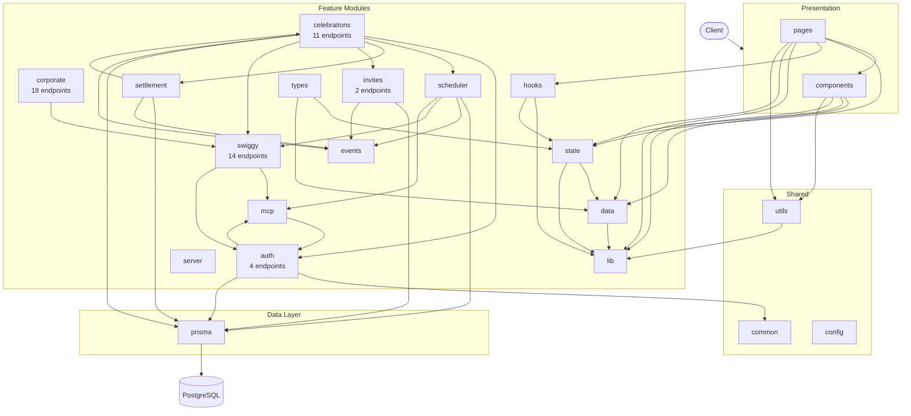
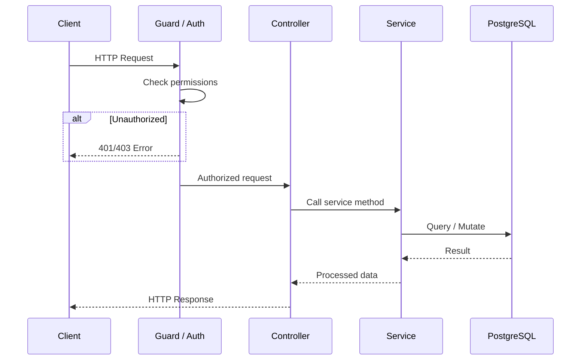

# CaterKart — generated code map

> **This file is generated and will be stale between runs.** It is a mechanical
> index of modules, endpoints and files — useful for finding things, not for
> understanding them.
>
> **The authoritative architecture document is
> [docs/ARCHITECTURE.md](docs/ARCHITECTURE.md)**, which is hand-maintained and
> explains the orchestration, the Swiggy integration and the decisions behind
> both. Start there.
>
> Known drift in the generated content below, as of November 2026: it describes
> the app as "scheduling", reports 0 data models (there are ~20 Prisma models
> plus the Mongo collections), lists only PostgreSQL (MongoDB and Redis are also
> in use), omits the entire CaterBox surface (~40 endpoints under `/api/ck/*`),
> and its environment-variable list predates several required secrets. Treat
> `server/.env.example` and `docs/ARCHITECTURE.md` as correct where they differ.

*Auto-generated by [zinsight](https://github.com/zinwave/zinsight) on 2026-07-13*

## What This App Does

**Swiggy Celebrations** is a **full-stack web application** built with **React, React DOM** that enables users to manage scheduling.

The codebase follows a **modular, controller-service** architecture — each feature is a self-contained module with clear separation between HTTP handling (controllers), business logic (services), and data access (schemas).

### Core Capabilities

- **Scheduling**
- **User authentication and authorization** — 4 endpoints
- **Shopping cart**
- **Search functionality**

### Infrastructure

- Configuration management

In total, the system exposes **49** API endpoints, **23** modules.

**Connects to:** **PostgreSQL** for data storage

## Overview

| **112** files · **15,317** lines of code · **23** modules · **49** API endpoints · **0** data models · PostgreSQL |
|---|

## At a Glance

A 60-second mental snapshot — what calls in, what we call out, where state lives.



## Core Concepts

Domain vocabulary used throughout the codebase. Read this first if names look unfamiliar.

| Term | Kind | What it means | Defined in |
|------|------|---------------|------------|
| **Auth** | `route` | HTTP resource at `/auth` (4 endpoints). Sample: `/auth/swiggy/begin`. | `server/src/auth/auth.controller.ts` |
| **Celebrations** | `route` | HTTP resource at `/celebrations` (11 endpoints). Sample: `/celebrations`. | `server/src/celebrations/celebrations.controller.ts` |
| **Invites** | `route` | HTTP resource at `/invites` (2 endpoints). Sample: `/invites/:token`. | `server/src/invites/invites.controller.ts` |
| **Swiggy** | `route` | HTTP resource at `/swiggy` (14 endpoints). Sample: `/swiggy/addresses`. | `server/src/swiggy/swiggy.controller.ts` |
| **Work** | `route` | HTTP resource at `/work` (18 endpoints). Sample: `/work/catalogue`. | `server/src/corporate/corporate.controller.ts` |
| **AuthService** | `service` | Service class — encapsulates business logic for one feature area. | `server/src/auth/auth.service.ts` |
| **CelebrationsService** | `service` | Service class — encapsulates business logic for one feature area. | `server/src/celebrations/celebrations.service.ts` |
| **CorporateService** | `service` | Service class — encapsulates business logic for one feature area. | `server/src/corporate/corporate.service.ts` |
| **CryptoService** | `service` | Service class — encapsulates business logic for one feature area. | `server/src/common/crypto.service.ts` |
| **EventsService** | `service` | Service class — encapsulates business logic for one feature area. | `server/src/events/events.service.ts` |
| **FoodService** | `service` | Service class — encapsulates business logic for one feature area. | `server/src/swiggy/food.service.ts` |
| **InstamartService** | `service` | Service class — encapsulates business logic for one feature area. | `server/src/swiggy/instamart.service.ts` |
| **InvitesService** | `service` | Service class — encapsulates business logic for one feature area. | `server/src/invites/invites.service.ts` |
| **McpClientService** | `service` | Service class — encapsulates business logic for one feature area. | `server/src/mcp/mcp-client.service.ts` |
| **PlacementPlannerService** | `service` | Service class — encapsulates business logic for one feature area. | `server/src/scheduler/placement-planner.service.ts` |
| **PrismaService** | `service` | Service class — encapsulates business logic for one feature area. | `server/src/prisma/prisma.service.ts` |
| **SchedulerService** | `service` | Service class — encapsulates business logic for one feature area. | `server/src/scheduler/scheduler.service.ts` |
| **SettlementService** | `service` | Service class — encapsulates business logic for one feature area. | `server/src/settlement/settlement.service.ts` |

## Walking Through One Request

The most-trafficked path is **`GET /work/group-orders/:id`**. Picked from the corporate.controller.ts (18 endpoints in that file) — typical read-by-id path through the system.

Trace this once and you understand the whole request lifecycle.

1. **Client sends GET /work/group-orders/:id**
2. **Controller `groupOrder()` is invoked** — `server/src/corporate/corporate.controller.ts`
   Defined in server/src/corporate/corporate.controller.ts.
3. **Service `groupOrder()` runs business logic** — `server/src/corporate/corporate.service.ts`
   Controller delegates to the matching service; data validation and authorization checks live here.
4. **Reads/writes POSTGRESQL**
   Scoped query (typically by orgId) against the `work` collection.
5. **Response returned to client (JSON)**
   NestJS / Express serializes the service return value.

## Frontend at a Glance

**Framework:** React (Vite) · **Router:** `react-router` · **Components:** 23 · **Pages:** 19 · **Styling:** Tailwind CSS

### Routes

| Path | Component | File |
|------|-----------|------|
| `/` | `Home` | `src/App.tsx` |
| `/login` | `PersonalLogin` | `src/App.tsx` |
| `/create` | `RequirePersonal` | `src/App.tsx` |
| `/group` | `RequirePersonal` | `src/App.tsx` |
| `/addons` | `RequirePersonal` | `src/App.tsx` |
| `/confirm` | `RequirePersonal` | `src/App.tsx` |
| `/orders` | `RequirePersonal` | `src/App.tsx` |
| `/orders/:id` | `RequirePersonal` | `src/App.tsx` |
| `/invite/:token` | `InviteGuest` | `src/App.tsx` |
| `/work/login` | `WorkLogin` | `src/App.tsx` |
| `/work` | `Work` | `src/App.tsx` |
| `/work/order` | `Work` | `src/App.tsx` |
| `/work/group/:id` | `Work` | `src/App.tsx` |
| `/work/join/:token` | `Work` | `src/App.tsx` |
| `/work/invoices` | `Work` | `src/App.tsx` |
| `/work/invoices/:id` | `Work` | `src/App.tsx` |
| `/work/settings` | `Work` | `src/App.tsx` |
| `/work/org` | `Work` | `src/App.tsx` |
| `/work/ops` | `Work` | `src/App.tsx` |
| `*` | `Navigate` | `src/App.tsx` |

### Client-side State

- **React Context** (6)
  -  `C` — `src/state/CelebrationContext.tsx`
  -  `C` — `src/state/CorporateContext.tsx`
  -  `C` — `src/state/OrdersContext.tsx`
  -  `C` — `src/state/PersonalAuthContext.tsx`
  -  `C` — `src/state/SwiggyContext.tsx`
  -  `C` — `src/state/WorkAuthContext.tsx`

## Where State Lives

Every persistence and caching surface in the system.

- **Persistent (database)** — POSTGRESQL — 0 models, 4 distinct operations.
  - Sample files: `src/components/DishPicker.tsx`, `src/components/FilterBar.tsx`, `src/components/Header.tsx`, `src/components/RestaurantCard.tsx`, `src/components/Timeline.tsx`
- **Environment variables** — 17 environment variables drive runtime behaviour.
- **File system** — Local file system writes detected — server is not fully stateless.
  - Sample files: `server/tools/swiggy.mjs`

## Lifecycle

Things that happen when the app boots, when requests arrive, and when external systems trigger us.

**On boot**

- Application bootstrap (trigger: `Process start`) — `src/main.tsx`

**Per request**

- Per-request lifecycle: middleware → guards → controller → service → response (trigger: `Each HTTP request`)

## How to Get Productive

Pick a goal — read the listed files in order — be productive in minutes, not days.

### Understand the request lifecycle (15 min)

1. `src/main.tsx` — Where the app boots and registers everything.
2. `server/src/swiggy/swiggy.controller.ts` — Representative controller — read to see the public API surface.

### Add a new feature (template to copy) (10 min)

1. `server/src/events/events.controller.ts` — Routes + DTOs.
2. `server/src/events/events.module.ts` — Module wiring — what to register.
3. `server/src/events/events.service.ts` — Business logic.

## Where to Look

Common questions answered up front. If you want to change something, this tells you which files to open.

| If you want to change... | Look in |
|--------------------------|---------|
| **Authentication / Login** — _Identity, sessions, login flows._ | `server/src/auth/auth.controller.ts`, `server/src/auth/auth.module.ts`, `server/src/auth/auth.service.ts`, `server/src/auth/current-user.decorator.ts` |
| **Configuration / Environment** — _Where env vars are read and the server bootstraps._ | `server/src/config/configuration.ts`, `server/src/main.ts` |
| **Logging** — _Structured logs and log destinations._ | `server/src/auth/auth.controller.ts`, `server/src/auth/auth.service.ts`, `server/src/corporate/corporate.service.ts`, `server/src/main.ts`, `server/src/mcp/mcp-client.service.ts` |
| **Background jobs / Queues** — _Async work, cron, queue consumers._ | `server/src/scheduler/placement-planner.service.ts`, `server/src/scheduler/placement.processor.ts`, `server/src/scheduler/scheduler.constants.ts`, `server/src/scheduler/scheduler.module.ts`, `server/src/scheduler/scheduler.service.ts` |
| **Payments / Billing** — _Payment processing or subscription billing._ | `src/pages/Invoices.tsx` |

## What This Repo Isn't

Stops you looking for things that don't exist here.

- **No file uploads** — _No multer/busboy/formidable/FileInterceptor usage detected._
- **No payment processing** — _No payment-provider SDK or service detected._
- **Single-region deployment (no multi-region replication detected)** — _No explicit multi-region configuration found._

## Table of Contents

- [What This App Does](#what-this-app-does)
- [Overview](#overview)
- [At a Glance](#at-a-glance)
- [Core Concepts](#core-concepts)
- [Walking Through One Request](#walking-through-one-request)
- [Frontend at a Glance](#frontend-at-a-glance)
- [Where State Lives](#where-state-lives)
- [Lifecycle](#lifecycle)
- [How to Get Productive](#how-to-get-productive)
- [Where to Look](#where-to-look)
- [What This Repo Isn't](#what-this-repo-isnt)
- [Tech Stack](#tech-stack)
- [Architecture](#architecture)
- [Modules](#modules)
- [API Endpoints](#api-endpoints)
- [Database](#database)
- [Deployment](#deployment)
- [Environment Variables](#environment-variables)
- [Getting Started](#getting-started)
- [Hotspots](#hotspots)
- [New Developer Guide](#new-developer-guide)

## Tech Stack

| Category | Technologies |
|----------|-------------|
| **Runtime** | Node.js |
| **Languages** | TypeScript, JavaScript |
| **Frameworks** | React, React DOM |
| **Build & Dev Tools** | TypeScript, Vite |

## Architecture



### Request Lifecycle



## Modules

| Module | Purpose | Files | Lines |
|--------|---------|-------|-------|
| **components** | UI components. | 24 | 2,667 |
| **pages** | Top-level page/route views. | 19 | 5,160 |
| **corporate** | CRUD APIs for work (18 endpoints). | 7 | 1,075 |
| **scheduler** | Scheduled task orchestration. | 6 | 517 |
| **lib** | Feature module — 6 files, 6 public exports. | 6 | 822 |
| **state** | Feature module — 6 files, 6 public exports. | 6 | 1,196 |
| **swiggy** | Read APIs for swiggy (14 endpoints). | 5 | 804 |
| **auth** | Identity, sessions, role guards. Every request passes through here. (4 endpoints) | 4 | 279 |
| **celebrations** | CRUD APIs for celebrations (11 endpoints). | 4 | 303 |
| **mcp** | Feature module — 4 files, 4 public exports. | 4 | 564 |
| **events** | Feature module — 3 files, 2 public exports. | 3 | 65 |
| **invites** | CRUD APIs for invites (2 endpoints). | 3 | 96 |
| **prisma** | Feature module — 2 files, 2 public exports. | 2 | 32 |
| **settlement** | Feature module — 2 files, 2 public exports. | 2 | 140 |
| **data** | Feature module — 2 files, 2 public exports. | 2 | 289 |
| **hooks** | Custom React hooks. | 2 | 205 |
| **common** | Shared helpers and cross-cutting utilities. | 1 | 72 |
| **config** | Configuration loading and constants. | 1 | 36 |
| **server** | Feature module — 1 file, 0 public exports. | 1 | 337 |
| **types** | Shared TypeScript type definitions. | 1 | 158 |
| **utils** | Shared helpers and cross-cutting utilities. | 1 | 96 |

## API Endpoints — 49 endpoints

### Corporate — 18 endpoints

`server/src/corporate/corporate.controller.ts`

| Method | Path | Handler | Description |
|--------|------|---------|-------------|
| GET | `/work/catalogue` | `catalogue`| Catalogue |
| PATCH | `/work/company` | `updateCompany`| Update company |
| PATCH | `/work/cost-centers/:id` | `updateCostCenter`| Update cost center |
| POST | `/work/group-orders` | `createGroupOrder`| Create group order |
| GET | `/work/group-orders/:id` | `groupOrder`| Group order |
| POST | `/work/group-orders/:id/cancel` | `cancel`| Cancel |
| POST | `/work/group-orders/:id/join` | `join`| Join |
| PUT | `/work/group-orders/:id/participants/:employeeId/lines` | `setLines`| Set lines |
| POST | `/work/group-orders/:id/participants/:employeeId/submit` | `submit`| Submit data |
| POST | `/work/group-orders/:id/place` | `place`| Place |
| GET | `/work/invoices/:id` | `invoice`| Invoice |
| GET | `/work/invoices/:id/export.csv` | `exportCsv`| Export csv |
| POST | `/work/invoices/:id/status` | `setInvoiceStatus`| Set invoice status |
| GET | `/work/join/:token` | `byToken`| By token |
| GET | `/work/overview` | `overview`| Overview |
| GET | `/work/session` | `session`| Session |
| POST | `/work/session/sign-in` | `signIn`| Authenticate user and get access token |
| POST | `/work/session/sign-in-by-email` | `signInByEmail`| Sign in by email |

### Swiggy — 14 endpoints

`server/src/swiggy/swiggy.controller.ts`

| Method | Path | Handler | Description |
|--------|------|---------|-------------|
| GET | `/swiggy/addresses` | `addresses`| Add resses |
| DELETE | `/swiggy/cart` | `flushCart`| Flush cart |
| GET | `/swiggy/cart` | `getCart`| Get cart |
| POST | `/swiggy/cart` | `updateCart`| Update cart |
| POST | `/swiggy/cart/coupon` | `applyCoupon`| Apply coupon |
| GET | `/swiggy/dishes` | `dishes`| Dishes |
| GET | `/swiggy/instamart/go-to` | `goTo`| Go to |
| GET | `/swiggy/instamart/search` | `search`| Search data |
| GET | `/swiggy/orders` | `orders`| Orders |
| POST | `/swiggy/orders` | `place`| Place |
| GET | `/swiggy/orders/:orderId` | `orderDetails`| Order details |
| GET | `/swiggy/orders/:orderId/track` | `track`| Track |
| GET | `/swiggy/restaurants` | `restaurants`| Restaurants |
| GET | `/swiggy/restaurants/:restaurantId/menu` | `menu`| Menu |

### Celebrations — 11 endpoints

`server/src/celebrations/celebrations.controller.ts`

| Method | Path | Handler | Description |
|--------|------|---------|-------------|
| GET | `/celebrations` | `list`| List celebrations |
| POST | `/celebrations` | `create`| Create a new celebrations |
| GET | `/celebrations/:id` | `get`| Get celebrations |
| PUT | `/celebrations/:id/address` | `setAddress`| Set address |
| POST | `/celebrations/:id/invites` | `invite`| Send invitation |
| POST | `/celebrations/:id/place` | `place`| Place |
| POST | `/celebrations/:id/settle` | `settle`| Settle |
| POST | `/celebrations/:id/shares/:shareId/paid` | `markPaid`| Mark paid |
| DELETE | `/celebrations/:id/suborders/:subOrderId` | `removeSubOrder`| Remove sub order |
| POST | `/celebrations/:id/suborders/food` | `addFood`| Add food |
| POST | `/celebrations/:id/suborders/instamart` | `addInstamart`| Add instamart |

### Auth — 4 endpoints

`server/src/auth/auth.controller.ts`

| Method | Path | Handler | Description |
|--------|------|---------|-------------|
| POST | `/auth/swiggy/begin` | `begin`| Begin |
| GET | `/auth/swiggy/callback` | `callback`| Handle OAuth callback |
| POST | `/auth/swiggy/disconnect` | `disconnect`| Disconnect integration |
| GET | `/auth/swiggy/status` | `status`| Get service status |

### Invites — 2 endpoints

`server/src/invites/invites.controller.ts`

| Method | Path | Handler | Description |
|--------|------|---------|-------------|
| GET | `/invites/:token` | `preview`| Preview |
| POST | `/invites/:token/accept` | `accept`| Accept |

## Database

| **PostgreSQL** — 0 models |
|---|

### Connection

| Variable | Used in |
|----------|---------|
| `DATABASE_URL` | `server/src/config/configuration.ts` |
| `REDIS_URL` | `server/src/config/configuration.ts` |

### Running Database Locally

Start a local PostgreSQL instance:

```bash
docker run -d --name postgres -p 5432:5432 -e POSTGRES_PASSWORD=postgres postgres:latest
```

**Operations used:** `delete`, `from`, `join`, `update`

**Schema / config files:** `server/src/prisma/prisma.service.ts`

## Deployment

### Docker

| Dockerfile | Base Image | Exposed Ports | Multi-stage |
|-----------|-----------|---------------|-------------|
| `server/Dockerfile` | `node:22-alpine` | 4000 | Yes (build → runtime) |

## Environment Variables

### Required vs Optional

**2 required** (no fallback) · **15 optional** (default present in code).

| Required Variable | Risk if missing |
|-------------------|-----------------|
| `DATABASE_URL` | Server cannot connect to its database — startup will fail or queries will throw. |
| `ENABLE_QUEUES` | Unknown — depends on what this variable controls. |

| Optional Variable | Default | Risk if missing |
|-------------------|---------|-----------------|
| `APP_JWT_SECRET` | `<redacted>` | Auth/sessions will fail or be insecure with default value. |
| `CONVERGENCE_TOLERANCE_MIN` | `5` | Unknown — depends on what this variable controls. |
| `FOOD_ORDER_CAP_RUPEES` | `1000` | Unknown — depends on what this variable controls. |
| `MCP_BASE_URL` | `https://mcp.swiggy.com` | Unknown — depends on what this variable controls. |
| `MCP_DINEOUT_PATH` | `/dineout` | Unknown — depends on what this variable controls. |
| `MCP_FOOD_PATH` | `/food` | Unknown — depends on what this variable controls. |
| `MCP_INSTAMART_PATH` | `/im` | Unknown — depends on what this variable controls. |
| `MCP_OAUTH_REDIRECT_URI` | `http://localhost:4000/auth/swiggy/callback` | Unknown — depends on what this variable controls. |
| `MCP_OAUTH_SCOPE` | `mcp:tools` | Unknown — depends on what this variable controls. |
| `PORT` | `4000` | Server defaults to a fallback port. |
| `PREDROP_LEAD_MIN` | `15` | Unknown — depends on what this variable controls. |
| `REDIS_URL` | `redis://localhost:6379` | Server cannot connect to its database — startup will fail or queries will throw. |
| `TOKEN_ENC_KEY` | `<redacted>` | Unknown — depends on what this variable controls. |
| `TRACKING_POLL_MIN_MS` | `10000` | Unknown — depends on what this variable controls. |
| `WEB_ORIGIN` | `http://localhost:5173` | Unknown — depends on what this variable controls. |

**Authentication & Secrets**

| Variable | Used in |
|----------|---------|
| `MCP_OAUTH_REDIRECT_URI` | `server/src/config/configuration.ts` |
| `MCP_OAUTH_SCOPE` | `server/src/config/configuration.ts` |
| `TOKEN_ENC_KEY` | `server/src/config/configuration.ts` |
| `APP_JWT_SECRET` | `server/src/config/configuration.ts` |

**Database**

| Variable | Used in |
|----------|---------|
| `DATABASE_URL` | `server/src/config/configuration.ts` |
| `REDIS_URL` | `server/src/config/configuration.ts` |

**Server**

| Variable | Used in |
|----------|---------|
| `PORT` | `server/src/config/configuration.ts` |
| `WEB_ORIGIN` | `server/src/config/configuration.ts` |
| `MCP_BASE_URL` | `server/src/config/configuration.ts`, `server/tools/swiggy.mjs` |

**Application**

| Variable | Used in |
|----------|---------|
| `ENABLE_QUEUES` | `server/src/app.module.ts`, `server/src/celebrations/celebrations.module.ts` |
| `MCP_FOOD_PATH` | `server/src/config/configuration.ts` |
| `MCP_INSTAMART_PATH` | `server/src/config/configuration.ts` |
| `MCP_DINEOUT_PATH` | `server/src/config/configuration.ts` |
| `FOOD_ORDER_CAP_RUPEES` | `server/src/config/configuration.ts` |
| `TRACKING_POLL_MIN_MS` | `server/src/config/configuration.ts` |
| `CONVERGENCE_TOLERANCE_MIN` | `server/src/config/configuration.ts` |
| `PREDROP_LEAD_MIN` | `server/src/config/configuration.ts` |

## Getting Started

### Prerequisites

- **Node.js** (check `.nvmrc` or `engines` in package.json for version)
- **npm** as package manager
- **Docker** (optional, for containerized setup)

### Installation

```bash
# Clone the repository
git clone <repository-url>
cd <project-directory>

# Install dependencies
npm install

# Set up environment variables
cp .env.example .env  # then fill in your values
```

### Running Locally

```bash
# Start development server with hot reload
npm run dev

# Build for production
npm run build

```

### Docker

```bash
# Build and run
docker build -t app -f server/Dockerfile .
docker run -p 4000:4000 app
```

## Usage Examples

> Example API calls for key endpoints. Replace `localhost:3000` with your actual host.

```bash
# get
curl -X GET http://localhost:3000/celebrations/{id}

# callback
curl -X GET http://localhost:3000/auth/swiggy/callback

# begin
curl -X POST http://localhost:3000/auth/swiggy/begin \
  -H "Content-Type: application/json" \
  -d '{ }'

# setAddress
curl -X PUT http://localhost:3000/celebrations/{id}/address \
  -H "Content-Type: application/json" \
  -d '{ }'

# removeSubOrder
curl -X DELETE http://localhost:3000/celebrations/{id}/suborders/{subOrderId}
```

## Hotspots

Files most-changed in the last 180 days. Hotspots = where bugs live and where docs matter most.

| Rank | File | Changes | Authors | Last touched |
|------|------|---------|---------|--------------|
| 1 | `src/components/icons/Icons.tsx` | 2 | 1 | 2026-04-29 |
| 2 | `src/pages/Home.tsx` | 2 | 1 | 2026-04-29 |
| 3 | `tailwind.config.js` | 2 | 1 | 2026-04-29 |
| 4 | `postcss.config.js` | 1 | 1 | 2026-04-29 |
| 5 | `src/App.tsx` | 1 | 1 | 2026-04-29 |
| 6 | `src/components/AddGuestModal.tsx` | 1 | 1 | 2026-04-29 |
| 7 | `src/components/AddonCard.tsx` | 1 | 1 | 2026-04-29 |
| 8 | `src/components/BillSplit.tsx` | 1 | 1 | 2026-04-29 |
| 9 | `src/components/DishRow.tsx` | 1 | 1 | 2026-04-29 |
| 10 | `src/components/FilterBar.tsx` | 1 | 1 | 2026-04-29 |
| 11 | `src/components/Footer.tsx` | 1 | 1 | 2026-04-29 |
| 12 | `src/components/Header.tsx` | 1 | 1 | 2026-04-29 |
| 13 | `src/components/IconButton.tsx` | 1 | 1 | 2026-04-29 |
| 14 | `src/components/MemberAvatar.tsx` | 1 | 1 | 2026-04-29 |
| 15 | `src/components/RestaurantCard.tsx` | 1 | 1 | 2026-04-29 |
| _… 16 more files with changes_ | | | | |

## New Developer Guide

> Everything you need to get oriented in this codebase as a new team member.

### Project Structure

```
├── src/
│   ├── pages/              # Pages module (19 files, 5,160 loc)
│   ├── components/         # Components module (24 files, 2,667 loc)
│   ├── state/              # State module (6 files, 1,196 loc)
│   ├── lib/                # Lib module (6 files, 822 loc)
│   ├── data/               # Data module (2 files, 289 loc)
│   ├── hooks/              # Hooks module (2 files, 205 loc)
│   ├── types/              # Types module (1 files, 158 loc)
│   └── utils/              # Utility functions (1 files, 96 loc)
└── server/
    ├── src/
    │   ├── corporate/      # Feature module (API + business logic) (7 files, 1,075 loc)
    │   ├── swiggy/         # Feature module (API + business logic) (5 files, 804 loc)
    │   ├── mcp/            # Business logic / services (4 files, 564 loc)
    │   ├── scheduler/      # Business logic / services (6 files, 517 loc)
    │   ├── celebrations/   # Feature module (API + business logic) (4 files, 303 loc)
    │   ├── auth/           # Authentication & authorization (4 files, 279 loc)
    │   ├── settlement/     # Business logic / services (2 files, 140 loc)
    │   ├── invites/        # Feature module (API + business logic) (3 files, 96 loc)
    │   ├── common/         # Shared utilities & helpers (1 files, 72 loc)
    │   ├── events/         # Feature module (API + business logic) (3 files, 65 loc)
    │   ├── config/         # App configuration (1 files, 36 loc)
    │   └── prisma/         # Database ORM setup (2 files, 32 loc)
    └── tools/              # Server module (1 files, 337 loc)
```

### Key Files

| # | File | Category | Lines | Why read this |
|---|------|----------|-------|---------------|
| 1 | `server/src/app.module.ts` | Configuration | 55 | Root module that wires together all feature modules, middleware, and providers — the dependency injection map for the entire app |
| 2 | `src/state/PersonalAuthContext.tsx` | Security | 110 | Core auth module referenced by 4 files — handles authentication flow, token validation, and session management. Key exports: PersonalUser, MOCK_OTP, initialsFor, normalizePhone (+2 more) |
| 3 | `src/state/WorkAuthContext.tsx` | Security | 247 | Core auth module referenced by 4 files — handles authentication flow, token validation, and session management. Key exports: WorkRole, Org, WorkMember, WORK_MOCK_OTP (+2 more) |
| 4 | `server/src/auth/auth.service.ts` | Security | 193 | Core auth module referenced by 3 files — handles authentication flow, token validation, and session management. Key exports: AuthService |
| 5 | `src/lib/mcp/types.ts` | Type Definitions | 151 | Shared type contracts imported by 16 files — defines: AddressId, RestaurantId, ItemId, SpinId (+14 more) |
| 6 | `server/src/mcp/mcp.types.ts` | Type Definitions | 397 | Shared type contracts imported by 6 files — defines: ServerKey, AddressId, RestaurantId, ItemId (+34 more) |
| 7 | `src/components/icons/Icons.tsx` | Business Logic | 371 | Core module imported by 31 files — exports: IconMapPin, IconSearch, IconBell, IconReceipt (+45 more). |
| 8 | `src/state/CorporateContext.tsx` | Business Logic | 230 | Core module imported by 12 files — exports: OrderLine, Participant, GroupOrder, TeamOrder (+9 more). |
| 9 | `src/state/CelebrationContext.tsx` | Business Logic | 267 | Core module imported by 11 files — exports: CartLine, CelebrationProvider, useCelebration. |
| 10 | `server/src/corporate/corporate.controller.ts` | API Surface | 102 | Defines the corporate API surface with 18 endpoints (GET: 7, POST: 8, PUT: 1, PATCH: 2) — read to understand request/response contracts |
| 11 | `server/src/swiggy/swiggy.controller.ts` | API Surface | 135 | Defines the swiggy API surface with 14 endpoints (GET: 10, POST: 3, DELETE: 1) — read to understand request/response contracts |
| 12 | `server/src/celebrations/celebrations.controller.ts` | API Surface | 90 | Defines the celebrations API surface with 11 endpoints (GET: 2, POST: 7, PUT: 1, DELETE: 1) — read to understand request/response contracts |

### Patterns

- **Module-Controller-Service (NestJS)** — Each feature is a self-contained module with a controller (handles HTTP) and service (business logic). New features follow the same pattern: create `feature.module.ts`, `feature.controller.ts`, `feature.service.ts`.
- **DTO Validation** — Data Transfer Objects validate and shape incoming request data. Create matching DTOs for new endpoints to ensure type safety.
- **Custom Decorators** — The codebase uses custom decorators for cross-cutting concerns (e.g., `@Public()`, `@Roles()`). Check the decorator files to understand available annotations.

### Common Tasks

| If you want to... | Start here | Pattern to follow |
|-------------------|-----------|-------------------|
| Add a new API endpoint | `server/src/celebrations/celebrations.controller.ts` | Copy an existing controller+service pair and register the module |
| Add an environment variable | `server/src/config/configuration.ts` | Add to `.env`, reference via `process.env.VAR_NAME` or config service |
| Understand the startup flow | `src/main.tsx` | Follow imports from main → app module → feature modules |
| Debug a failing request | Check controller → service → database query in that order | Most bugs are in the service layer |

---

*Generated by [zinsight](https://github.com/zinwave/zinsight)*
